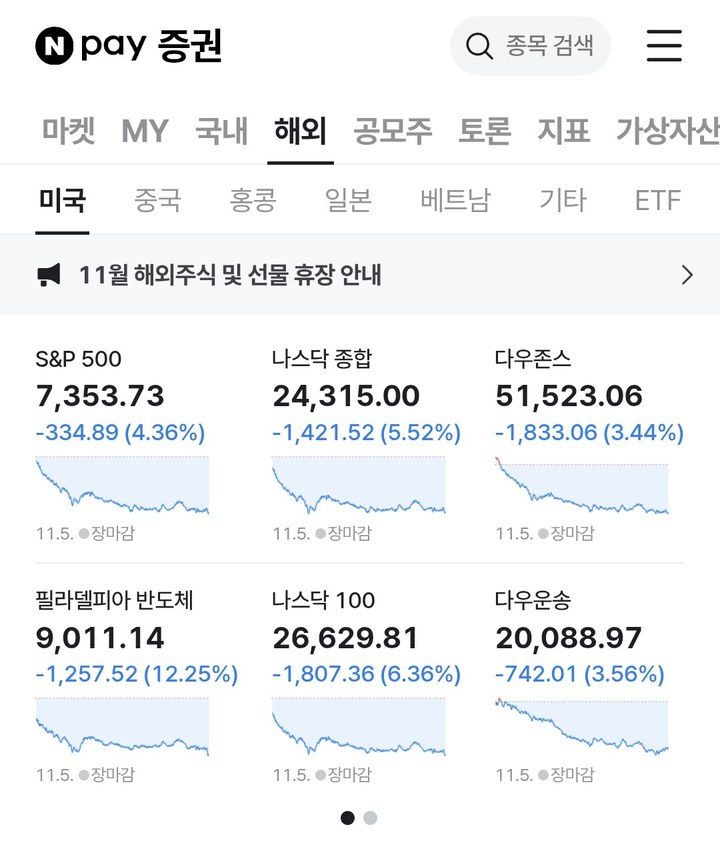

## 3줄 요약

1. 나스닥 -5%, 필라델피아 -11%
2. 청산, 규제, 앤트로픽이 원인
3. 배당주로 방어, 2차 분할매수

### [미국 주식 폭락(26.11.05)]

- 나스닥 -5%, 필라델피아 -11%
- 미국채 10년물 4.82%
- 주식 팔고 채권 사는 흐름(위험자산 → 안전자산)
- 평가 : AI 트레이드가 흔들리는 중

### [AI 섹터 하락 원인 3가지]

- 기준 : 빅테크 데이터센터 투자 늘리는 가정으로 성장
- 원인1 : 헷지펀드들의 포지션 청산
- (AI 섹터 집중 투자 해소 + 비중 관리에 따른 강제 매각).
- 원인2 : 민주당 압승 & 데이터센터 규제
- (민주당 당선구역 중 데이터센터 건설 규제될 곳 많음)
- (코어위브 등 데이터센터 사업들의 리스크 증가)
- 원인3 : 투자금 마르는 상황 속 앤트로픽 상장
- (상장 1000억불 조달하려는데 최근 분위기는 힘듦)

### [위험자산이 진짜 위험한 상황]

- 금리인상 확률 낮아짐(채권 장기보다 단기 더 빠짐)
- 금, 헬스케어, 필수소비재 종목 위주로 방어됨
- 연준이 굳이 금리 안 올려도 되게 자정작용이 되버림

### [오늘 미장에 대한 낙관 vs 비관]

- 낙관 : 정책 리스크 올랐지만 청산 일시적 수급 충격
- 비관 : 수급 충격 + 데이터센터 규제 + 앤트로픽 상장
- (이란과 전쟁 마무리해서 분위기 전환시켜야 할 듯)

정리하면,

- 헤지펀드들의 AI 섹터 포지션 정리
- 민주당 압승으로 데이터센터 규제
- 불투명한 AI 시장 상황에서 앤트로픽의 상장
- 일시적 충격이든 아니든 규제 리스크는 확실히 생김

{: .mid}

할 말이 없음ㅎ; 1년에 1~2번 오는 크리티컬 어택... 
보유 종목 대다수가 털리고 배당주로 겨우 방어. 
그리고 FG, VIX 모두 범위에 들어서 2차 분할매수 진행.

AI에 대해서는 섹터가 망할 느낌은 아니다. 
그렇지 않아도 이번에 여러 박람회를 다녀보면서 AI 사용이 많이 늘다 못해 이제 필수 도구로 자리 잡은 걸 체감하는데 이 상황에서 꺾이기는 아닌 것 같다. 낙관론을 펼치기 어렵지만 기본으로 깔고 가는 투자 생각.

그나저나 케빈 워시가 말한대로 흘러가는 게 가장 먼저 떠올랐음. 굳이 금리 인상 안 시켜도 되게 시장이 자정작용으로 금리 회복될 거라고 했는데 그렇게 되어가네...

그리고 트럼프는 애초에 정리도 못할 전쟁을 왜 시작해서 여러 국가랑 사람들 피곤하게 만드는지...

### 출처 : 「오늘 미장에 무슨 일이 일어났나?」
{: .src}

원문 : [메르의 블로그](https://m.blog.naver.com/ranto28/224466693885) 
내 블로그 : [멍멍짱구 작업실](https://m.blog.naver.com/kgu3405/)
