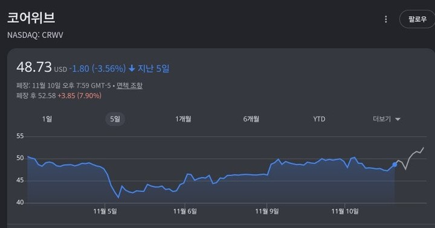

## 3줄 요약

1. 분기매출이 컨센서스 초과
2. 선수금 90억 불 확보
3. 선거결과와 상관없이 건설 가능

### [코어위브 실적]

- 분기매출 : 컨센서스, 가이던스 모두 초과
- 영업이익 : +10%
- CAPEX : 예상치보다 하단만 조금 상향
- 자금조달 : 선수금(90억 불) 확보
- 부채총액 : 전분기 대비 110억 불 증가
- *총평 : 평이하되 부채만큼 선수금 받은 게 긍정적

### [컨퍼런스 콜, Q&A]

- 현재의 높은 금리에서 채권 쓰지 않을 것
- 거래처와 선수금 등 써서 자금 조달 받을 거고
- 확실한 수익이 보이는 부문에만 선별적 투자예정
- 선거결과와 상관없이 데이터센터 건설 가능

{: .mid}

코어위브가 카나리아 역할을 하는 중인데 
일단 우려하던 자금조달, CAPEX, 블루웨이브에 따른 데이터센터 인허가 문제 등을 모두 그럭저럭 잘 풀어나갔다는 것 같음.

하지만 이걸로 AI 수익성 논란 문제를 100% 종식 시킬 수는 없고 앞으로도 한동안은 시끄러울 수 있을 것 같음. 특히 이번에 민주당이 선거에서 대승을 거두면서 엔비디아를 비롯해 빅테크들을 때리기 시작했는데... 이 과정에서 AI 섹터 전반이 계속 출렁일 것 같음.

AI는 트렌드로 확실히 잡힌거라 출렁임은 있어도 방향은 변하지 않았기에 투자 걸어두고 노이즈에 귀닫고 쭉 가져가야할 것 같음. 다만 그렇게 버티고 기다리는 게 스트레스 일뿐... ㅋㅋ;

### 출처 : 「이번주에 봐야할 한가지가 있다면?」
{: .src}

원문 : [메르의 블로그](https://m.blog.naver.com/ranto28/224472527236) 
내 블로그 : [멍멍짱구 작업실](https://m.blog.naver.com/kgu3405/)
