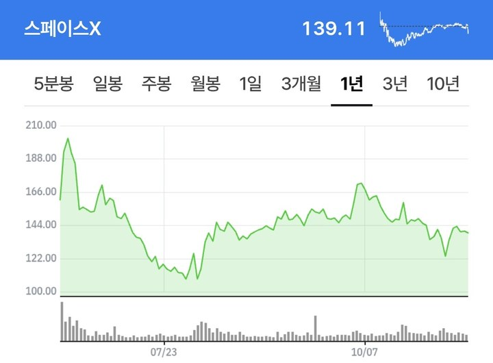

## 3줄 요약

1. 데이터센터 반대가 확대됨
2. 스페이스X, 우주 데이터센터 준비
3. 구글, 중국도 테스트 중

### [미국 데이터센터 반대 확대]

- 데이터센터 : 전기료 인상, 물 부족, 송전탑 → 기피대상
- 공화당 중간선거 패배 원인 중 데이터센터가 큰 영향

### [반대로 좋아진 우주 데이터센터]

- 우주 데이터센터는 지상의 문제점들이 모두 해소됨
- 스페이스X가 우주 데이터센터용 위성을 쏠 준비
- 새 로켓 발사/착륙 기술 성공시켜 발사비용 줄임
- 발사 무게 제한 없어서 저렴한 태양광 패널 사용가능
- DARPA에서 무인 우주 조립기술 테스트 성공
- *저비용 발사 × 저비용 소재 × 무인 조립
- 궁극적으로는 달 기지에서 생산/발사하는 걸 목표로 함

### [다른 기업들도 참여 중]

- 구글 등 타기업도 테스트 중(스페이스X 우주선 빌려서)
- 중국도 우주 데이터센터 테스트 중

정리하면,

- 데이터센터 여론 안 좋음(물/전기 부족, 인허가 문제)
- 스페이스X는 지상 대신 우주 데이터센터로 문제 해결
- 저비용 소재, 발사비용 절감, 신조립기술로 가능성 커짐
- 구글 등 타기업도 테스트 중(스페이스X 우주선 빌려서)
- 중국도 정부 중심으로 기술 개발 중

{: .mid}

스타링크 상용화, 로켓 이착륙 보면서 이미 스페이스X에 대해 검증이 끝난 상황에서 이번 우주 데이터센터에 대한 머스크의 플랜이 실현 가능성이 느껴지고 웅장해지는데 또 끌림이 온다.(이게 머스크의 매력이지)

다른 얘기지만 이번 세무사 AI 안경 이슈도 그렇고 좋든 나쁘든 이미 AI 는 방향성이 정해졌고 데이터센터 등 더 많은 리소스가 필요할 수 밖에 없다.

그 필요성을 중국까지도 느껴서 시도하는 걸 보면 우주 데이터센터는 필수적 요소가 될 지도 모르겠다.

### 출처 : 「머스크의 우주 데이터센터 괜찮을까?」
{: .src}

원문 : 메르의 블로그 
내 블로그 : [멍멍짱구 작업실](https://m.blog.naver.com/kgu3405/)
