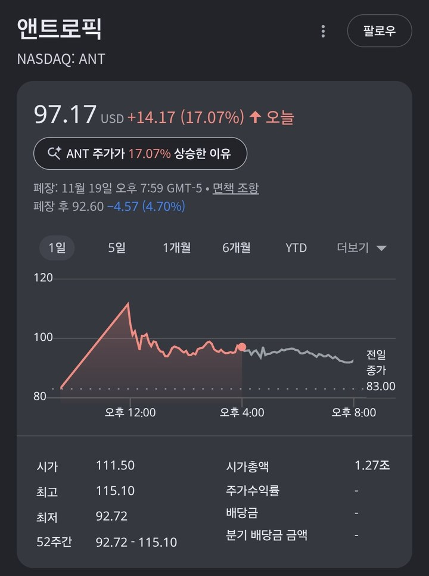

## 3줄 요약

1. 1년간 락업 해제 물량 쌓임
2. 공모물량은 총 물량의 20%
3. 상장 첫해 평균 수익률 4%

### [앤트로픽 상장]

- 공모가 : 83불 → 상장일 종가 97불(+34%)

### [수급 상황]

- 1) 기존주주 : 상장일부터 락업 물량의 10% 매도 가능
- 2) 공모물량 : 총 물량의 20%가 공모주
- (누적량 : 26년 말 56억 주?... +5400억불 풀릴 예정)
- 3) 지수편입 : 나스닥 펀드 매수 발생(+190억불)

### [공모주들 상장일 추이]

- 테슬라(40%), ARM(25%), 스페이스X(19%)
- 상장 첫해 평균 수익률 4% 수준
- *단기간 오르고 이후 조정으로 4% 수준 마무리 된다는

정리하면,

- 1년간은 락업 해제 물량 쌓여있음(가격 상승 제한)
- 상장 당일은 많이 올라도 연평균으로 평균 4% 수렴

{: .phone}

드디어 앤트로픽이 상장했는데... 
시기가 영 안 좋은 게 아쉽다. 앤트로픽은 메르님도 매수 희망을 언급했었을만큼 사업성과 트렌드 모두 좋으니 담아보려는데 락업 고려해서 분할로 모아보려고 한다.

매월 2주(24주) + 보너스달 5주(20주) ... 
내년 말까지 50주 이상 모아봐야지!

### 출처 : 「앤트로픽 상장 첫날 상황과 수급은?」
{: .src}

원문 : [메르의 블로그](https://m.blog.naver.com/ranto28/224484233298) 
내 블로그 : [멍멍짱구 작업실](https://m.blog.naver.com/kgu3405/)
