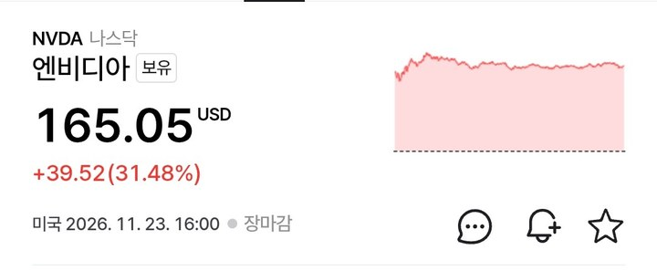

## 3줄 요약

1. 젠슨황이 11일 만에 복귀
2. 단기 기대감, 중기는 조사 통과
3. CEO 리스크 해소, '덮어줬다'

### [젠슨황 엔비디아 CEO 복귀]

- 트럼프의 푸시(+중국 기업의 젠슨황 영입 우려)
- 11일 만에 복귀

### [투자 측면]

- 단기 : 평소대로 엔비디아 잘 굴러갈 기대감
- 중기 : 의회, SEC, 법무부 조사 통과해야
- 장기 : 27~28년 AI CAPEX 증가 흐름 이어져야
- 이슈별로 주가 계속 출렁일 가능성 큼
- CEO 리스크 해소됐지만 '대통령이 덮어줬다'

{: .mid}

어제 +3%도 아니고 +30% 오르는 걸 보고 무슨 일이 났구나 싶었는데 그렇게 젠슨황 CEO 복귀 소식을 거꾸로 알게 됐었다. 근데 +30% 올랐어도 고점 대비 많이 빠져서 갈길은 먼 것 같다.

메르님 말처럼 단기적으로는 엔비디아, 시장 전반에 대해 호재는 맞는데 검증 받아야 할 게 많아서 이슈가 완전히 덮히고 본 궤도에 오를 때까지는 시간이 좀 걸릴 것 같다.

또 지금 계속 나오는 뉴스들을 보면 사실상 중국이 동남아 등의 우회 루트를 통해 엔비디아 고사양 칩을 이용하고 있었는데 이 부분이 앞으로 규제로 막히는 만큼 수익성(마진률)의 감소가 있을 것 같다. 그렇다해도 본 사업과 수주잔고 등에서 밀릴 일은 없지만 다음 분기 실적 때 그 감소분이 보이지 않을까 싶다.(드라마틱한 감소가 있지 않은 이상은 사업성은 여전히 좋다고 생각되지만)

한편 트럼프가 젠슨황과의 친분, 중국에서 황을 영입할 가능성 등을 우려한 것도 있겠지만 시장의, 그 중에서도 AI 사슬의 중심에 있는 황이 눌리면 시장도 영향을 받다보니 여론 등을 생각해서 움직인 것도 같은데.

여튼 개인적으로는 다행이다 싶으면서도 솔직히 한번 사두면 거의 팔지 않는 내 성향상 이번 CEO 리스크는 컸고 모든 투자 기업들에 대한 의구심을 만들었다. 그리고 ETF로 가서 이런 불피요 리스크는 보완하는 게 좋겠다는 생각도 들게 했고.

여담으로 어제 엔비디아를 비롯 반도체 종목들 전반이 급등했지만 앤트로픽은 거의 상승없이 공모가 수준에서 머무르고 있는데 이번에 단기 수익이 생기는대로 조금씩 매수 들어가야겠다.

### 출처 : 「젠슨 황 복귀, 가장 큰 승자는 누구?」
{: .src}

원문 : [메르의 블로그](https://m.blog.naver.com/ranto28/224489348434) 
내 블로그 : [멍멍짱구 작업실](https://m.blog.naver.com/kgu3405/)
