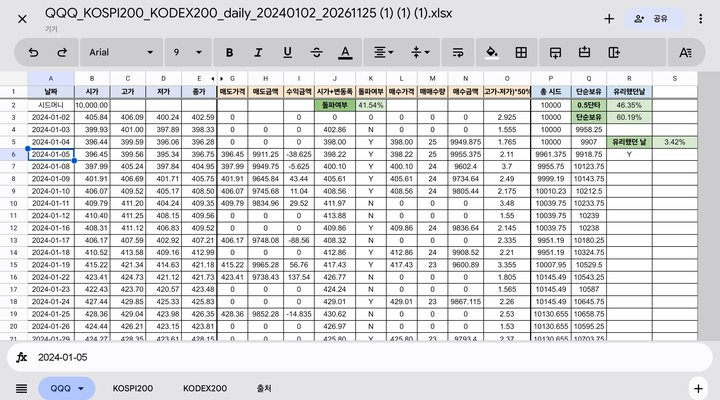
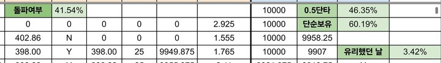
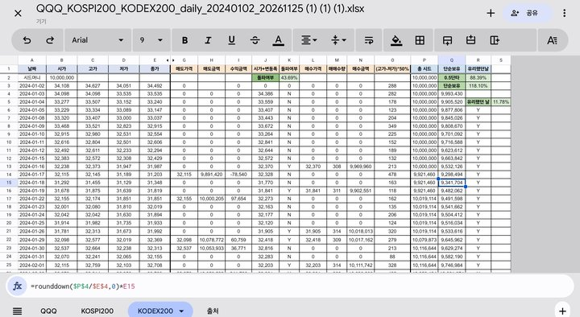
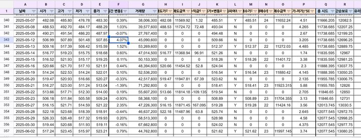

유튜브를 보던 중 진짜인가 싶어 시뮬레이션 해봤습니다.

## 3줄 요약

1. 나스닥 : 0.5단타공식 46%, 보유 60%
2. 코스피도 단순보유가 앞섬
3. 결론은 사서 쭉 보유하기

내용을 보니 월가의 유명 투자자 래리 윌리엄스가 **0.5 단타 공식**이라는 걸 써서 1000만원을 11억원으로 만들었다고 하는데 룰은 이렇습니다. 참고로 검색해보니 진짜 이름은 **변동성 돌파전략**이라고 합니다.
룰은 이렇습니다.

- 1일차 : 변동폭 = (고가 - 저가) x 50% 계산
- 2일차 : 기준선 = (시가 + 전일 변동폭)을 양봉 돌파하면 매수
- 3일차 : 전일 매수량을 시초가에서 전량매도

이렇게 단타를 치면 S&P500 보다 더 좋은 수익률이 나온다고 하는데 그럴 수도 있을 것도 같고 뜬구름 같기도 하고 애매합니다.

생각해보면 이런거죠.
전날 변동폭의 반 정도만큼 주가 저항을 뚫어낸다면 **시장에 '힘(모멘텀)'이 있다는 걸로 보고** 매수 진입하고, 다음 날은 시장에 상관없이 목표만큼만 **욕심없이 익절**한다는 겁니다.
(반대로 힘이 없는 시장은 진입조차 안하구요)

AI를 써도 됩니다만 눈으로 흐름을 따라가고 싶어서 엑셀을 이용해서 테스트 해봤습니다.

## 1. 나스닥(QQQ)

첫 대상은 미국 주식의 근본 나스닥(QQQ)로 해봤습니다.
나스닥(QQQ) 2024년 1월 ~ 2026년 11월까지 데이터를 준비하고 룰에 따라 열을 추가했습니다.

- 시드머니 : 10,000불로 가정
- 매수가격(L열) : 시가 + 전일 변동폭의 50%
- **매매수량(M열) : 시드머니 / 매수가격**
- 돌파여부(K열) : 당일 고가 > 기준선 가격 일 때 Y
- 매도금액(H열) : (당일 시가 - 전일 매수가격) x 매매수량

이렇게 반복시키고 수익(손실)이 발생한 건 시드머니에 다시 더하고 이걸 계속 반복시키는 연산을 시켰습니다. 결과는 어땠을까요?

### [수익률 비교]

- 0.5단타공식 : 46.35%
- 단순보유 : 60.19%

### [상단돌파(=매수한 날)]

- 41.54%

### [유리했던 날(0.5단타공식 수익률이 더 좋은 날)]

- 3.42%

약 3년의 기간 동안 46% 수익률(연평균 15%)이 괜찮은 것 같지만 단순보유만 했을 때도 더 좋은 수익률 60%를 찍으니 의미가 반감됩니다. 게다가 이 전략은 매매가 많고 **그만큼 거래 수수료도 빼야하니** 실수익률은 더 떨어질테구요.

나스닥은 이랬고 혹시 모르니 코스피에서는 다른 결과가 나올 지 궁금해서 추가로 실험을 해봤습니다.

## 2. 코스피

동일기간 2024년 1월 ~ 2026년 11월까지의 코스피 데이터에도 적용해봤습니다. 참고로 코스피는 26년 상반기 급등한 이례적인 상황이 있었으니 이걸 감안하기는 해야합니다.

### [수익률 비교]

- 0.5단타공식 : 88.39%
- 단순보유 : 118.10%

### [상단돌파(=매수한 날)]

43%

### [유리했던 날(0.5단타공식 수익률이 더 좋은 날)]

12.15%

상단돌파했던 날의 비중은 40%대로 비슷한데
수익률은 0.5단타공식과 단순보유간에 30% 정도 차이가 납니다.
0.5단타공식은 왕복 거래수수료가 있으니 실제 갭은 좀 더 있을거구요.

## 3. 왜 단순보유(Buy & Hold)가 좋았나

표를 보면 나스닥 하루 상승률이 4.07% 였던 날이 있습니다.
그런데 **돌파여부(L열)는 N**입니다.
변동성 돌파전략 필터에는 걸리지 않았는데 **가만히 보유**만 하고 있었으면 큰 수익률을 얻을 수 있었는데 그걸 놓쳤습니다.

그리고 쉽게 예상할 수 있는 날 중에는 미국에서 CPI, PCE 같은 주요 지표를 발표할 때 장이 열릴 때와 끝날 때 **가격이 상승 반전**하는 경우도 자주 나오는데요. 이런 경우도 놓칠 가능성이 큽니다.
(장 초반에 변동성이 약하다고 판단해서 진입하지 않았는데... 끝 무렵에 크게 상승하면서 마무리 된 경우)

## 4. 오늘의 결론

리밸런싱, 포트폴리오 변화를 위한 특별한 이벤트가 없다면 **시장에 몸을 담고 흘러가는대로 가는 게** 좋다고 합니다.

오늘 본 0.5단타공식은 그나마 마이너스 수익률은 아니었지만
Buy&Hold 전략보다는 훨씬 못 미치는 성과를 보입니다.

결국 요행을 부려봤자 별 의미없고 심플하게 사서 쭉 보유하는 게 좋다는 걸 또 한 번 확인합니다. 끝!
